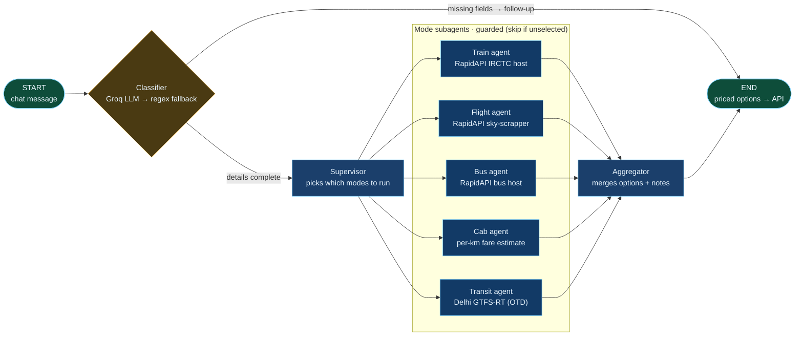

# Destinify Backend (FastAPI + uv)

## Setup

```powershell
cd backend
uv venv
uv sync
copy .env.example .env   # then fill in your keys
```

## Run

```powershell
uv run uvicorn app.main:app --reload
```

- API: http://localhost:8000
- Docs: http://localhost:8000/docs
- Health: http://localhost:8000/api/v1/health

**Run order:** start this backend on `:8000` first, then the frontend
(`cd ../frontend && npm run dev`, http://localhost:3000). The frontend calls
`NEXT_PUBLIC_API_URL` (default `http://localhost:8000`) and drops into a
scripted demo mode when the backend is unreachable.

## Environment

| Var                     | Purpose                                                          |
| ----------------------- | ---------------------------------------------------------------- |
| `BACKEND_CORS_ORIGINS`  | Origins allowed to call the API — comma-separated or JSON list   |
| `GROQ_API_KEY`          | Groq key for the classifier LLM (falls back to regex if empty)   |
| `GROQ_MODEL`            | Groq model, default `openai/gpt-oss-120b`                        |
| `LLM_MODEL` / `LLM_BASE_URL` / `LLM_API_KEY` | Optional overrides — see below              |
| `RAPID_API_KEY` + hosts | RapidAPI keys for train/flight/bus lookups                       |
| `OTD_DELHI_API`         | OTD Delhi GTFS-RT key for live transit                           |

`LLM_MODEL` takes precedence over `GROQ_MODEL` when picking the Groq model.
When `LLM_BASE_URL` **and** `LLM_MODEL` are set and `langchain-openai` is
installed, any OpenAI-compatible endpoint is used instead.

Without keys the API still works: the classifier falls back to regex
extraction and mode agents return estimated prices with a note explaining
that the live lookup failed.

## Agent flow



Notes:

- `classifier` short-circuits to `END` when required travel details are missing
  (follow-up questions); otherwise it routes to `supervisor`.
- The classifier pulls structured fields out of the message with Groq
  structured output (`json_schema`, nullable schema — the model nulls out
  anything the message doesn't state) and normalises them into the typed
  `TravelDetails` state. Any LLM failure logs a warning and falls back to
  regex extraction, so the endpoint never 500s on provider issues.
- The API is stateless (`{message}` only), so the frontend prefixes each turn
  with `Latest message: … Trip context: …` — follow-ups like "make it 3
  travellers" then resolve against the trip instead of arriving bare.
- The supervisor fans out to the selected mode subagents in parallel, then every
  mode fans into `aggregator`.
- Mode nodes are **guarded**: an unselected mode returns an empty delta so it
  never pollutes state.
