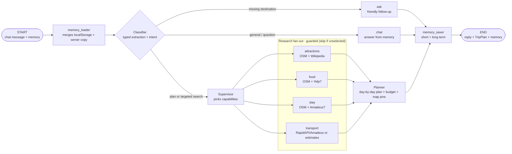

# Destinify Backend (FastAPI + LangChain/LangGraph)

The all-in-one trip agent: one chat turn researches real places, food, stays and
transport for a destination and returns a typed day-by-day `TripPlan` (itinerary,
budget, map pins, images) plus the traveller's updated long/short-term memory.

## Setup

```powershell
cd backend
uv venv
uv sync
copy .env.example .env   # then fill in your keys (only the LLM key is really needed)
```

## Run

```powershell
uv run uvicorn app.main:app --reload
```

- API: http://localhost:8000
- Docs: http://localhost:8000/docs
- Health: http://localhost:8000/api/v1/health
- Provider flags (booleans only): http://localhost:8000/api/v1/chat/config

**Run order:** start this backend on `:8000` first, then the frontend
(`cd ../frontend && pnpm dev`, http://localhost:3000).

## Tests

```powershell
python -m pytest -q      # 26 offline tests: graph wiring, memory, planner, tools
```

The suite stubs the network and the LLM, so it runs fast and deterministically.

## Environment

| Var                     | Purpose                                                       |
| ----------------------- | ------------------------------------------------------------- |
| `BACKEND_CORS_ORIGINS`  | Origins allowed to call the API — comma-separated or JSON list |
| `GROQ_API_KEY`          | Groq key for the classifier/planner LLM (regex fallback if empty) |
| `GROQ_MODEL`            | Groq model, default `openai/gpt-oss-120b`                      |
| `LLM_MODEL` / `LLM_BASE_URL` / `LLM_API_KEY` | Optional overrides — see below             |
| `RAPID_API_KEY` + hosts | RapidAPI keys for live flight/train fares (optional)           |
| `OTD_DELHI_API`         | OTD Delhi GTFS-RT key for live transit (optional)              |
| `YELP_API_KEY`          | Auto-upgrade: restaurant photos + ratings                      |
| `AMADEUS_KEY` / `AMADEUS_SECRET` / `AMADEUS_HOST` | Auto-upgrade: live flight offers (free test env)   |
| `GEO_USER_AGENT`        | UA for OSM/Wikimedia — must keep the URL + email shape         |
| `OVERPASS_URL` / `OVERPASS_MIRRORS` | OpenStreetMap Overpass endpoint(s) + failover list  |
| `NOMINATIM_URL`         | Geocoder used for city lat/lon                                 |
| `OPENVERSE_IMAGES_URL` / `WIKIPEDIA_SUMMARY_URL` / `WIKIMEDIA_COMMONS_SEARCH_URL` | Free image sources |
| `SHORT_MEMORY_TURNS`    | Rolling window of short-term memory turns (default 12)         |
| `GEO_CACHE_TTL_SECONDS` | In-process geodata cache TTL (default 6h)                      |

`LLM_MODEL` takes precedence over `GROQ_MODEL` when picking the Groq model.
When `LLM_BASE_URL` **and** `LLM_MODEL` are set and `langchain-openai` is
installed, any OpenAI-compatible endpoint is used instead.

**Free-first data:** attractions, restaurants, hotels, geocoding and images all
come from no-key sources (OpenStreetMap, Wikipedia, Wikimedia Commons,
Openverse), so the product works with no API keys at all. Paid providers only
activate when their key is present.

## Agent flow



Notes:

- **Memory round-trip.** The frontend is the source of truth (localStorage) and
  sends `{message, session_id, memory}` on every turn; the graph returns the
  updated payload. A server-side copy per `session_id` backstops it.
- **Intent guard.** The latest message decides `intent`: a question about an
  existing plan ("best time to visit?") routes to `chat` and answers
  conversationally instead of re-running the planner, while "make it 5 days"
  re-plans — reusing the destination from memory when it is omitted.
- **Research fan-out.** The supervisor selects capabilities; each capability node
  is *guarded* (returns an empty delta when unselected) and the planner joins
  the results.
- **Planner.** The LLM sequences only real, indexed places from the research
  output (nothing is invented), so every activity, meal and map pin carries true
  lat/lon and image URLs. A deterministic fallback builds the plan when no LLM
  key is configured.
- **Transport.** Live fares come from RapidAPI/Amadeus when keyed; otherwise
  distance-based estimates for the known route, or *local* getting-around
  options when no departure city is known yet — never a fabricated fare.
- **LLM failures never 500.** Every LLM/network call degrades to a note plus a
  deterministic fallback.
